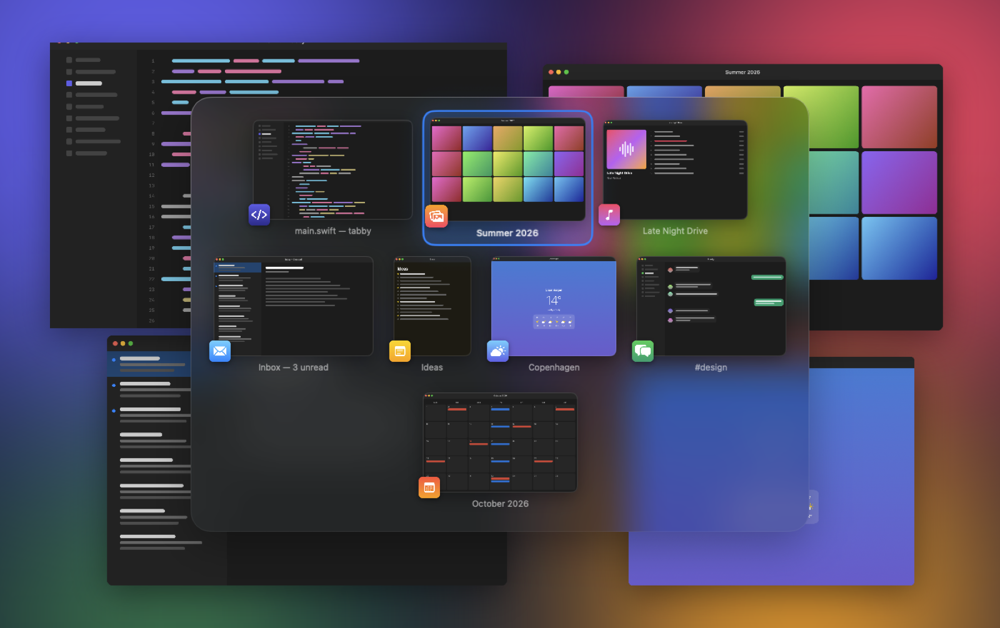
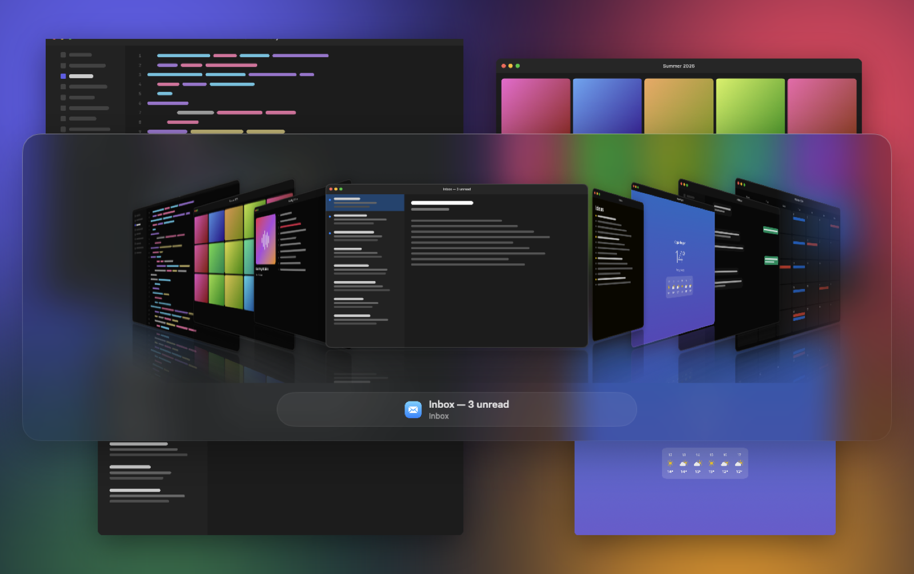
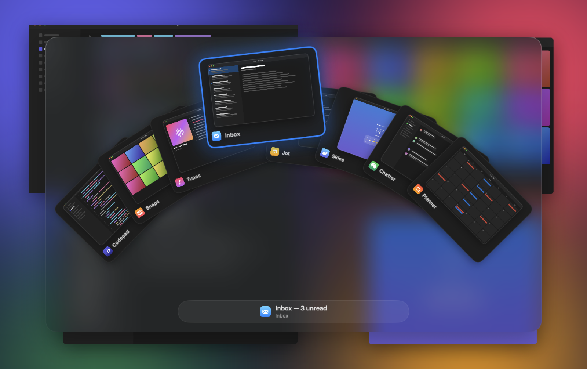
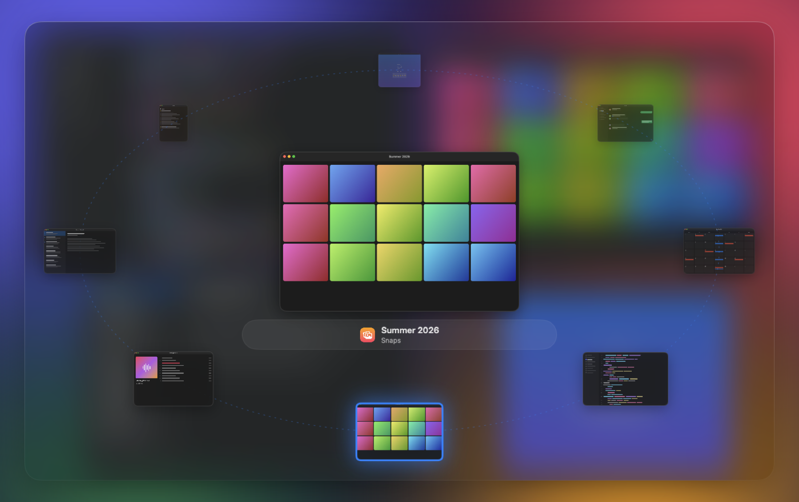
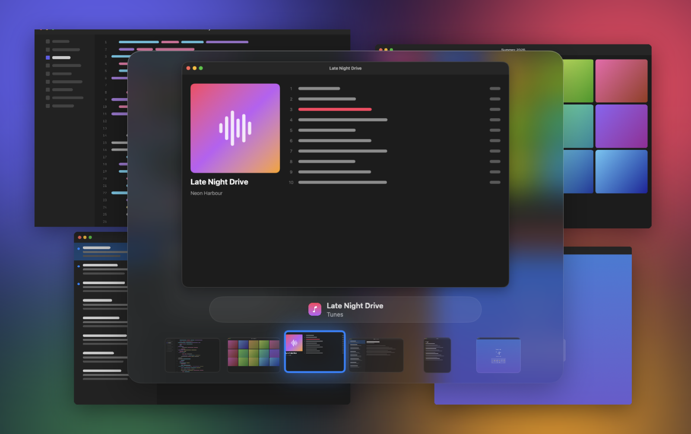
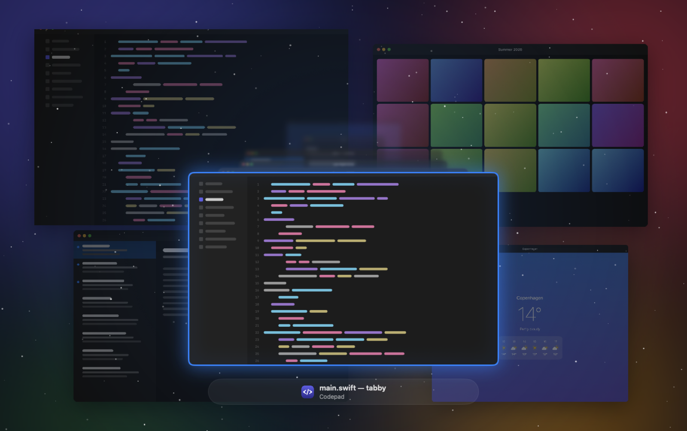
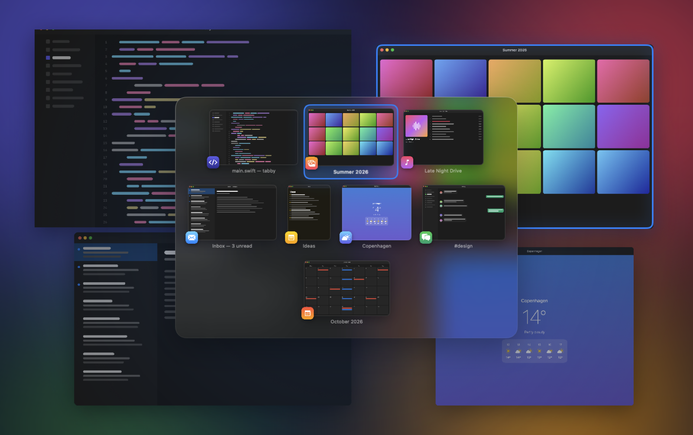

<div align="center">

# Tabby

**A fast, good-looking ⌥Tab window switcher for macOS.**

Hold ⌥, tap Tab, see every window as a live picture, let go to switch. That's the whole app.

[](https://github.com/ChristiantangCC/tabby/actions/workflows/ci.yml)
[](LICENSE)




</div>

## Why

macOS's own ⌘Tab switches between apps, not windows. Tools like AltTab fix that, but grow a settings screen for every edge case. Tabby does one thing: switch windows, quickly, and look nice doing it.

## Install

1. Download **[Tabby.zip](https://github.com/ChristiantangCC/tabby/releases/latest/download/Tabby.zip)** from the latest release, unzip it and move **Tabby** to Applications.
2. Open it. macOS will say it can't verify the developer, because Tabby is signed with my own certificate rather than a paid Apple one.
3. Go to **System Settings → Privacy & Security**, scroll down and click **Open Anyway** next to Tabby. You only do this once.
4. Grant the two permissions Tabby asks for:
   - **Accessibility:** to catch the shortcut and focus windows
   - **Screen Recording:** to draw window thumbnails

   Settings → General has a **Grant…** button for each.

Every release is signed with the same certificate, so updates keep both permissions. Tabby checks for new releases once a day and shows **Update available** in its menu and in Settings. You can turn that off in Settings → General.

## Layouts

Six ways to lay out your windows. Pick one in Settings → Layout.

| | |
| --- | --- |
| <br>**Thumbnails**: a grid of live pictures, each tile in its window's real shape | <br>**Cover Flow**: a 3D shelf with reflections that flips past as you tab |
| <br>**Deck**: windows fanned out like a hand of cards; the selected one lifts up | <br>**Orbit**: windows circle a large preview of the selected one |
| <br>**Spotlight**: one huge preview with a small strip of the rest | <br>**Time Machine**: windows stacked into the distance over a starfield |

### See where you're going

While you tab, the selected window's real spot on screen stays bright and gets an accent outline, so you know exactly which window you'll land on. Turn it off in Settings → Layout.



The screenshots use made-up apps. Run `.build/release/Tabby --demo -layout deck` to see the same demo.

## Settings

- **Layout:** one of the six above, plus size, animation speed, window titles and the on-screen highlight
- **Appearance:** light, dark or system; glass, solid or frameless surface; accent colour; dim the screen behind
- **Shortcut:** ⌥Tab by default. Click it in Settings and press a new one.

While the switcher is open: ⇧ goes backwards, arrow keys move, esc cancels, and releasing the modifier switches.

## Small and light

| | |
| --- | --- |
| **Download** | 1.3 MB zipped |
| **App** | 3.9 MB, universal (Intel + Apple Silicon) |
| **Memory, idle** | ~40 MB |
| **Memory, after switching** | ~60 MB, including cached thumbnails |
| **Dependencies** | None. Only Apple frameworks. |

Measured on Apple Silicon with macOS 26, using `footprint`.

## How it compares

| | Switches windows | Looks like | Price | Open source | App size |
| --- | :---: | --- | --- | :---: | --- |
| **Tabby** | ✅ | Live thumbnails, 6 layouts | Free | ✅ MIT | 3.9 MB |
| [AltTab](https://alt-tab.app) 11.9 | ✅ | Live thumbnails; app icons and titles styles in Pro | Free, Pro $9.99 | ✅ GPL-3.0 | 13 MB |
| [Witch](https://manytricks.com/witch/) 4.7 | ✅ | Window list | $14 | ❌ | — |
| [Contexts](https://contexts.co) 3.9 | ✅ | Window list and sidebar | $9.99 | ❌ | — |
| [HyperSwitch](https://bahoom.com/hyperswitch) 0.3 | ✅ | Live thumbnails | Free (beta) | ❌ | — |
| macOS ⌘Tab | ❌ apps only | App icons | Built in | ❌ | — |

Pick something else if you need more than switching. AltTab, Witch and Contexts all add window search, multiple shortcuts, per-app exceptions, and windows from other Spaces. Tabby leaves those out on purpose.

Prices and versions are from each developer's site, October 2026. App sizes are measured on disk; both Tabby and AltTab ship universal (Intel + Apple Silicon) apps.

## How it works

- Windows are listed through the Accessibility API, in parallel per app, starting the moment you press ⌥ so the list is usually ready before Tab lands.
- Thumbnails come from ScreenCaptureKit, captured only as large as the layout draws them.
- A window is focused with the same window-server calls AltTab and yabai use, so the exact window comes forward, not just its app.

Tabby only sees windows on the current Space.

## Development

### Build from source

You need the Swift toolchain (Swift 5.10+), from Xcode or the command line tools.

```sh
git clone https://github.com/ChristiantangCC/tabby.git
cd tabby
./scripts/build.sh
```

This builds `build/Tabby.app`, signs it (with your Apple Development certificate if you have one, otherwise ad-hoc) and copies it to `/Applications`. Pass `INSTALL=0` to skip the copy, or `ARCHS="arm64 x86_64"` for a universal build. Run the tests with `swift test`; CI runs them on every push and pull request. With an ad-hoc signature, macOS forgets both permissions after every rebuild.

### Releasing

Bump `CFBundleShortVersionString` in `Resources/Info.plist`, add a matching `## <version>` section to `CHANGELOG.md`, and push to main. CI builds a universal app, signs it and publishes `Tabby.zip` as a GitHub release.

## License

[MIT](LICENSE)
